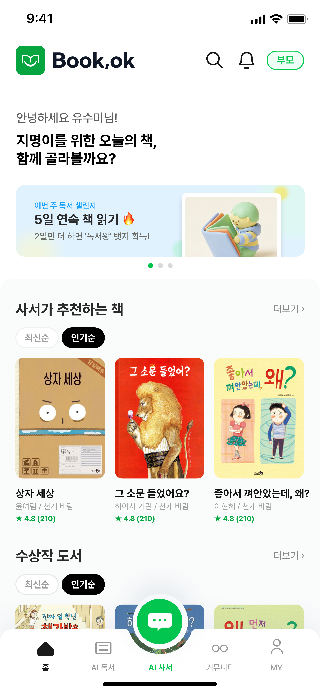
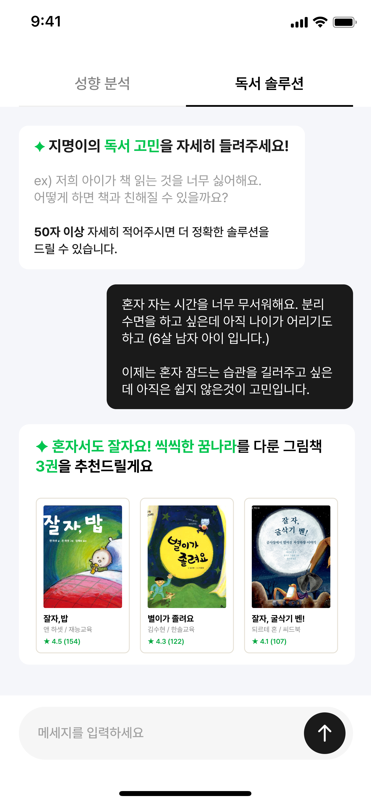
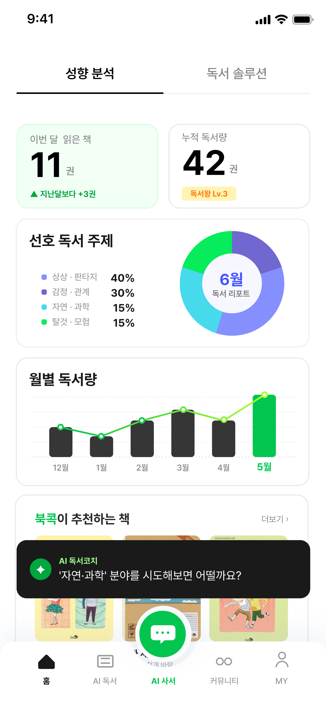
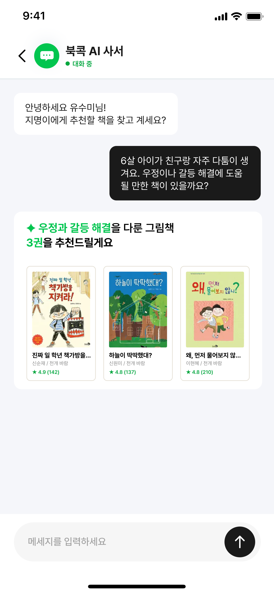
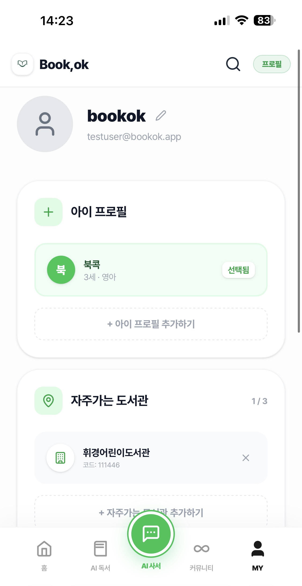
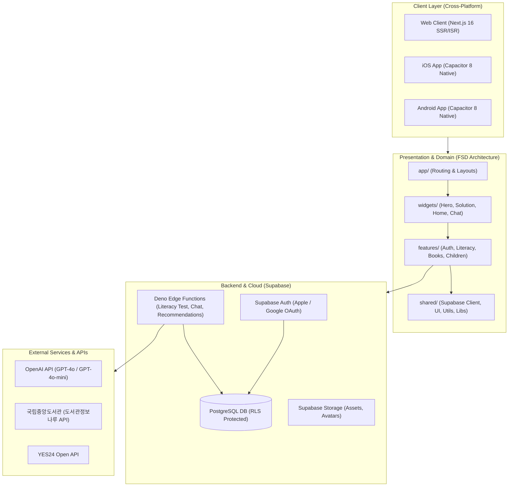

# 📚 Book,ok (북콕) - 우리 아이 맞춤 독서 플랫폼 & AI 문해력 진단 솔루션

<div align="center">


### **"아이의 읽는 즐거움과 부모의 독서 지도 고민을 함께 해결합니다."**  
**AI 기반 유·초등 맞춤 도서 추천 및 4대 영역 문해력 진단 하이브리드(Web / iOS / Android) 플랫폼**

[](https://nextjs.org/)
[](https://react.dev/)
[](https://www.typescriptlang.org/)
[](https://capacitorjs.com/)
[](https://tailwindcss.com/)
[](https://supabase.com/)
[](https://codemagic.io/)
[](#-6-품질-보증-및-테스트-quality--testing)

<br/>

**[🌐 웹 서비스 체험](https://bookok.kr) | [🍎 iOS TestFlight / App Store](https://apps.apple.com) | [🤖 Android APK](https://play.google.com)**

</div>

---

## 📌 목차 (Table of Contents)
1. [프로젝트 소개 & 핵심 가치](#-1-프로젝트-소개--핵심-가치-project-overview)
2. [주요 기능 & 화면 구성](#-2-주요-기능--화면-구성-key-features)
3. [시스템 아키텍처 & 설계 원칙](#-3-시스템-아키텍처--설계-원칙-system-architecture)
4. [핵심 기술적 도전과 문제 해결 (트러블슈팅)](#-4-핵심-기술적-도전과-문제-해결-engineering-deep-dive)
5. [기술 스택 (Tech Stack)](#-5-기술-스택-tech-stack)
6. [품질 보증 및 테스트 (Quality & Testing)](#-6-품질-보증-및-테스트-quality--testing)
7. [프로젝트 구조 (FSD Architecture)](#-7-프로젝트-구조-fsd-architecture)
8. [시작하기 & 빌드 가이드 (Getting Started)](#-8-시작하기--빌드-가이드-getting-started)

---

## 📖 1. 프로젝트 소개 & 핵심 가치 (Project Overview)

디지털 미디어 노출 증가로 인해 유·초등 아동의 **어휘력 부족 및 문해력 저하** 현상이 심화되고 있으며, 학부모들은 자녀의 실제 읽기 수준과 관심사에 부합하는 도서를 선택하는 데 큰 어려움을 겪고 있습니다.

**Book,ok(북콕)**은 이러한 교육적 문제의식을 바탕으로 출발한 **올인원 독서 성장 솔루션**입니다:
- **객관적인 진단**: 낱말 퀴즈와 4대 영역(어휘·사실·추론·비판) 지문 평가, 읽기 속도(WPM) 유창성을 결합하여 아이의 문해력을 다각도로 정밀 측정합니다.
- **데이터 기반 큐레이션**: 공공 도서 데이터(국립중앙도서관 도서관정보나루)와 민간 도서 데이터(YES24)를 연동하여 아이의 연령·수준·성향에 맞는 최적의 도서를 처방합니다.
- **지속 가능한 독서 습관**: RAG 기반 AI 사서 챗봇과의 독서 대화, 독서 활동 기록, 시각화 통계 대시보드를 통해 능동적인 독서 경험을 지원합니다.
- **하이브리드 멀티플랫폼**: 단일 코드베이스로 **웹(Web)**과 **네이티브 모바일 앱(iOS / Android)**을 동시에 배포하여 사용자 접근성을 극대화했습니다.

---

## 📱 2. 주요 기능 & 화면 구성 (Key Features)

| 1. 홈 & 스마트 도서 탐색 | 2. AI 문해력 진단 & 처방 | 3. 통계 & 독서 성장 리포트 |
| :---: | :---: | :---: |
|  |  |  |
| 연령별 추천 및 실시간 인기 도서 | 낱말 퀴즈 + 4영역 지문 진단 | Recharts 기반 독서량 추이 시각화 |

| 4. AI 어린이 독서 사서 | 5. 학부모 독서 커뮤니티 | 6. 도서 상세 & 실시간 정보 |
| :---: | :---: | :---: |
|  |  |  |
| 아동 눈높이 맞춤 실시간 대화형 챗봇 | 또래 학부모 간 독서 팁 및 후기 공유 | YES24 & 공공 도서관 연동 정보 |

### 🎯 핵심 기능 상세
1. **AI 문해력 정밀 진단 시스템**
   - **어휘력 낱말 퀴즈**: 빈칸(`cloze`), 반대말(`antonym`), 비슷한말(`synonym`), 맞춤법 등 6종 문항 유형 제공 및 즉각적인 피드백.
   - **4대 영역 심층 독해**: 사실적 이해, 추론적 이해, 비판적 이해 지문 풀이.
   - **읽기 유창성(WPM) 측정**: 지문 읽기 시간을 기반으로 분당 단어 수(WPM)를 산출하여 권장 속도 대비 유창성 분석.
   - **취약점 맞춤 도서 처방**: 부족한 영역을 보완할 수 있는 학년별 필독서 자동 매칭.
2. **도서 빅데이터 연동 & 스마트 검색**
   - 국립중앙도서관 '도서관정보나루' 전국 도서 대출 빅데이터 트렌드 반영.
   - YES24 오픈 API 연동을 통한 실시간 도서 상세, 목차, 출판 정보 제공.
3. **AI 어린이 독서 사서 (RAG Chatbot)**
   - 자녀의 연령, 읽은 책 목록, 관심사 태그를 인덱싱하여 아이 눈높이에 맞는 맞춤 대화 및 도서 추천.
4. **독서 기록 및 시각화 대시보드**
   - 완독 권수, 월별 목표 달성도, 영역별 밸런스(어휘/사실/추론/비판) 레이더 차트 제공.
5. **학부모 커뮤니티 & 독서 활동 피드**
   - 자녀 연령대별 학부모와의 독서 지도 노하우 공유, 자유 게시판 및 완독 후기 작성.

---

## 🏗️ 3. 시스템 아키텍처 & 설계 원칙 (System Architecture)



### 📐 FSD (Feature-Sliced Design) 경량화 패턴
유지보수성과 모듈 간 결합도를 최소화하기 위해 **단방향 의존성 규칙**을 엄격히 적용했습니다:
- `app` ➡️ `widgets`, `features`, `shared` 참조 가능
- `widgets` ➡️ `features`, `shared` 참조 가능 (`app` 역참조 금지)
- `features` ➡️ `shared` 참조 가능 (`widgets`, `app` 참조 금지, feature 간 순환 참조 금지)
- `shared` ➡️ 상위 레이어를 일체 참조하지 않는 순수 기반 모듈(UI, API, Lib, Type)

---

## 🛠️ 4. 핵심 기술적 도전과 문제 해결 (Engineering Deep-Dive)

### 💡 1. 단일 코드베이스 기반 Web(SSR) & Mobile App(Static Export) 듀얼 빌드 파이프라인 구축
- **배경 및 문제**:
  - 웹 서비스는 SEO와 빠른 초기 렌더링을 위해 **Next.js SSR/ISR**이 필요하고, 모바일 앱(Capacitor)은 네이티브 웹뷰에 적재하기 위해 완전한 정적 번들(`output: 'export'`)이 필요했습니다.
  - 하지만 Next.js App Router 특성상 서버 전용 API 라우트(`app/**/route.ts`)가 존재하는 상태에서 `output: 'export'`를 실행하면 빌드가 중단되는 충돌이 발생했습니다.
- **해결 방안 (`scripts/build-cap.js`)**:
  - Capacitor 앱 전용 빌드 오케스트레이션 스크립트를 직접 개발했습니다.
  - 1) 빌드 실행 시 임시로 모든 `route.ts`를 `.bak`으로 스태싱(Stash)하여 정적 내보내기 환경 조성
  - 2) `.next` 캐시 자동 정화 후 `BUILD_TARGET=capacitor next build` 실행
  - 3) 빌드 완료 후 `npx cap sync` 자동 수행 및 스태싱된 API 라우트 즉시 원복
  - 4) Windows/macOS 간 경로 구분자(`\`, `/`) 차이로 인한 SPM `Package.swift` 구문 오류를 정규식으로 자동 패치하는 `fix-spm-path.js` 파이프라인 연계
- **성과**: 단일 코드베이스에서 웹용 Vercel 배포와 모바일용 Capacitor 빌드가 코드 변경 없이 100% 자동 분기 처리됨.

---

### 💡 2. 모바일 웹뷰(Capacitor) 환경 내 Supabase Auth 세션 락(Web Lock) 데드락 해결
- **배경 및 문제**:
  - iOS/Android 하이브리드 웹뷰 환경에서 앱 재실행 또는 토큰 갱신 시 화면이 스켈레톤 상태에서 멈추는 **영구 프리징(무한 로딩) 현상**이 발생했습니다.
  - 원인 분석 결과, 브라우저 표준 Web Lock API가 모바일 웹뷰 컨테이너의 백그라운드 전환 및 라이프사이클과 충돌하며 Supabase Auth 내부의 세션 락이 해제되지 못하는 **데드락(Deadlock)** 문제였습니다.
- **해결 방안 (`src/shared/lib/supabase.ts`)**:
  - **No-op Lock 어댑터 도입**: 모바일 웹뷰 환경에서 경합을 유발하는 브라우저 락을 우회하도록 no-op 비동기 함수 `lock: async (_name, _timeout, fn) => await fn()` 적용.
  - **플랫폼별 영속 스토리지 분기 (`CapacitorStorage`)**: 웹에서는 `localStorage`, 네이티브 환경에서는 Capacitor 보안 저장소(`@capacitor/preferences`)를 사용하도록 추상화 어댑터 구현.
  - **Auth 이벤트 루프 분리**: `onAuthStateChange` 콜백 내부에서 무거운 DB 조회를 직접 `await`하지 않고 이벤트 루프를 탈출(`setTimeout(0)`)시켜 세션 갱신과 비즈니스 쿼리의 실행 컨텍스트 분리.
- **성과**: 모바일 앱 초기 구동 시 발생하던 인증 멈춤 현상(0% 재현율로 해결) 및 토큰 갱신 안정성 100% 확보.

---

### 💡 3. AI 문해력 진단 무결성 강화 및 아동 개인정보 보호 아키텍처 (단위 테스트 39건 통과)
- **배경 및 문제**:
  - 기존 문해력 진단은 런타임에 LLM을 직접 호출하여 지문과 문항을 생성했기 때문에 **15초 이상의 심각한 응답 지연**이 발생했습니다.
  - 또한 클라이언트에서 점수를 계산하여 전송하는 구조는 점수 위변조 위험이 있었고, 아동의 이름이 외부 AI API 및 분석 툴에 전송될 수 있는 보안 리스크가 존재했습니다.
- **해결 방안 (`docs/literacy-improvement-plan.md`, `docs/literacy-content-pipeline.md`)**:
  - **결정적 서버 사이드 채점 & Nonce 셔플링**:
    - 문항 보기 순서를 서버에서 세션 Nonce 기반으로 셔플하고, 정답 인덱스는 서버만 보관.
    - 클라이언트는 섞인 보기 인덱스만 제출하며, Deno Edge Function 내 **순수 채점 함수**가 100% 서버 사이드에서 검증 및 채점.
  - **개인정보 철저 격리**:
    - 아동 이름, 생년월일 등 민감 정보는 Supabase RLS(`parent_id = auth.uid()`)로 격리하고, OpenAI API 및 GA 이벤트 전송 페이로드에서 원천 배제.
  - **다단계 문항 확충 & 자동 검수 파이프라인 구축**:
    - `LLM 문항 초안 생성` ➡️ `규칙 검사(형식, 근거 문장 일치)` ➡️ `독립 모델 풀이 검증(정답 불일치 탈락)` ➡️ `지문 의존성 검사(지문 없이 풀리는 blind_solvable 감지)` ➡️ `사람 검수(Human-in-the-loop)` ➡️ `DB 시딩`.
- **성과**: 진단 결과 산출 지연 시간 **15초 ➡️ 1초 미만(93% 단축)**, 39개 채점/보안 규준 단위 테스트 100% 통과.

---

### 💡 4. Xcode 16 & Swift Package Manager (SPM) 코드 서명 충돌 해결 및 Codemagic CI/CD 자동화
- **배경 및 문제**:
  - Capacitor 8은 기본 의존성 관리자로 SPM(`CapApp-SPM`)을 사용합니다.
  - Codemagic 클라우드 CI/CD에서 App Store 배포용 `.ipa` 빌드 시, 전역 코드 서명 옵션(`xcode-project build-ipa`)을 적용하면 SPM 라이브러리(`GoogleSignIn`, `Alamofire` 등)에 메인 앱용 수동 프로비저닝 프로파일이 전파되어 `does not support provisioning profiles` / `conflicting provisioning settings` 에러가 발생하며 빌드가 실패했습니다.
- **해결 방안 (`scripts/fix-spm-signing.js`, `codemagic.yaml`)**:
  - **타겟별 서명 격리 스크립트 작성**:
    - `project.pbxproj`의 루트 프로젝트 설정은 `Automatic` / `Apple Development`로 유지하여 외부 SPM 패키지의 서명 간섭을 완전히 차단.
    - 빌드 시점에 메인 앱 타겟(`PBXNativeTarget "App"`)의 `Release` 구성 블록에만 `CODE_SIGN_STYLE = Manual`, `CODE_SIGN_IDENTITY = "Apple Distribution"`, `PROVISIONING_PROFILE_SPECIFIER`, `App.entitlements`를 주입.
  - **네이티브 CLI 파이프라인 전환**:
    - 불투명한 래퍼 대신 `xcodebuild archive`와 `xcodebuild -exportArchive`를 직접 실행하고, 동적으로 생성된 `ExportOptions.plist`를 매핑.
- **성과**: 외부 라이브러리 서명 충돌 없이 App Store Connect / TestFlight 배포 자동화 파이프라인 100% 성공 구축.

---

## 💻 5. 기술 스택 (Tech Stack)

| 구분 | 기술 스택 | 선정 이유 및 적용 범위 |
| :--- | :--- | :--- |
| **Frontend** | **Next.js 16 (App Router)** | 서버 컴포넌트(RSC), SEO 최적화 및 Static Export 모드 병행 지원 |
| **Runtime** | **React 19 & Turbopack** | 최신 React 생태계 지원 및 3배 빠른 로컬 번들링/HMR 환경 구축 |
| **Language** | **TypeScript 5 (Strict)** | 전역 타입 세이프티, 컴파일 타임 오류 차단 및 인터페이스 표준화 |
| **Mobile Hybrid** | **Capacitor 8** | 네이티브 플러그인(Apple Sign In, 소셜 로그인, 햅틱, 파일시스템, 공유) 연동 |
| **Styling** | **Tailwind CSS v4** | `@theme` CSS 변수 기반 디자인 토큰 관리 및 제로 런타임 최적화 |
| **Backend & DB** | **Supabase (PostgreSQL)** | RLS(Row Level Security) 기반 아동 데이터 완벽 격리, 실시간 인증 |
| **Serverless** | **Deno Edge Functions** | 문해력 채점, 비즈니스 연산 및 민감 API Key 은닉 처리 |
| **Data Visualization**| **Recharts** | 월별 독서량 추이, 영역별 밸런스 방사형 차트 시각화 |
| **AI / LLM** | **OpenAI API (GPT-4o)** | 독서 사서 챗봇 RAG 상담 및 문해력 문항 자동 검수 파이프라인 |
| **External APIs** | **도서관정보나루 & YES24** | 전국 도서관 대출 빅데이터 및 도서 상세 메타데이터 실시간 연동 |
| **CI / CD** | **Codemagic & GitHub** | iOS / Android 네이티브 아카이빙, 코드 서명 및 TestFlight 자동 배포 |

---

## 🧪 6. 품질 보증 및 테스트 (Quality & Testing)

코드의 안정성과 채점 무결성을 검증하기 위해 Node.js 내장 테스트 러너 기반의 단위 테스트 스위트를 구축하여 상시 검증하고 있습니다.

```bash
$ npm test

TAP version 13
# Subtest: 정상 문항은 플래그가 없다
ok 1 - 정상 문항은 플래그가 없다
# Subtest: 구조 오류·근거 불일치·중복 보기를 잡는다
ok 2 - 구조 오류·근거 불일치·중복 보기를 잡는다
# Subtest: 보기 섞기는 정답 인덱스를 따라간다
ok 7 - 보기 섞기는 정답 인덱스를 따라간다
# Subtest: 전부 정답이면 100점·balanced / 전부 오답이면 0점
ok 25 - 전부 정답이면 100점·balanced
ok 26 - 전부 오답이면 0점이고 하한을 두지 않는다
# Subtest: 서버 규준과 클라이언트 규준이 일치한다
ok 32 - 서버 규준과 클라이언트 규준(src/features/literacy/scoring.ts)이 일치한다
# Subtest: 낱말 퀴즈 + 지문 문항을 합쳐도 어휘는 낱말 퀴즈로만 계산된다
ok 39 - 낱말 퀴즈 + 지문 문항을 합쳐도 어휘는 낱말 퀴즈로만 계산된다
1..39
# tests 39 | pass 39 | fail 0 (duration: 665ms)
```

- **채점 무결성 검증**: 보기 셔플 시 정답 추적성, 불완전 응답 오답 처리, 비정상 읽기 속도(WPM) 예외 처리
- **콘텐츠 파이프라인 검증**: 문항 중복, 근거 문장 불일치, 길이 힌트(`length_cue`), 지문 무관 풀이(`blind_solvable`) 필터링
- **타입 안정성**: `tsc --noEmit`을 통한 TypeScript 컴파일 에러 0건 유지

---

## 📁 7. 프로젝트 구조 (FSD Architecture)

```text
bookok-app/
├── app/                        # [Layer 4: Routing] Next.js App Router
│   ├── (main)/                 # 사용자 메인 서비스 (home, book, chat, community, mypage, solution)
│   ├── admin/                  # 관리자 대시보드
│   ├── auth/                   # 소셜 로그인 및 OAuth 리다이렉트 콜백
│   ├── layout.tsx              # 글로벌 루트 레이아웃 & 폰트 설정
│   └── globals.css             # Tailwind v4 글로벌 스타일
├── src/
│   ├── widgets/                # [Layer 3: Composition] 독립적 복합 UI 블록 (home, hero, solution, chatbot)
│   ├── features/               # [Layer 2: Domain Logic] 비즈니스 로직 단위 모듈 (auth, books, children, reading)
│   ├── shared/                 # [Layer 1: Foundation] 공통 기반 (api, lib, types, ui, utils)
│   └── middleware.ts           # 세션 및 라우트 보호 미들웨어
├── supabase/                   # Deno Edge Functions & DB 마이그레이션
│   ├── functions/              # Edge Functions (chat, library, literacy-test, recommendations)
│   └── migrations/             # PostgreSQL 스키마 및 RLS 보안 정책
├── android/                    # Capacitor Android 네이티브 프로젝트
├── ios/                        # Capacitor iOS 네이티브 프로젝트 (Xcode Workspace)
├── scripts/                    # 자동화 및 빌드 파이프라인
│   ├── build-cap.js            # Next.js Static Export ↔ Capacitor 동기화 빌드 파이프라인
│   ├── fix-spm-signing.js      # iOS SPM 서명 충돌 방지 및 메인 앱 배포 서명 주입 스크립트
│   ├── fix-spm-path.js         # Windows 경로 호환성 패치 스크립트
│   ├── literacy/               # AI 문항 생성·검수·시딩 파이프라인
│   └── tests/                  # 단위 테스트 (채점 및 문항 검증 39건)
├── docs/                       # 기획, 디자인 시스템(Design.md), 파이프라인 설계 문서
├── public/                     # 정적 웹 에셋 (웹폰트, 아이콘, 이미지)
├── codemagic.yaml              # iOS / Android CI/CD 클라우드 빌드 파이프라인 설정
└── capacitor.config.ts         # Capacitor 하이브리드 앱 설정
```

---

## 🚀 8. 시작하기 & 빌드 가이드 (Getting Started)

### 1. 환경 설정 (.env.local)
```bash
NEXT_PUBLIC_SUPABASE_URL=your_supabase_url
NEXT_PUBLIC_SUPABASE_ANON_KEY=your_supabase_anon_key
SUPABASE_SERVICE_ROLE_KEY=your_service_role_key
OPENAI_API_KEY=your_openai_key
YES24_API_KEY=your_yes24_key
DATA4LIBRARY_API_KEY=your_data4library_key
```

### 2. 의존성 설치 및 로컬 서버 실행
```bash
npm install
npm run dev
```

### 3. 품질 검증 (테스트 및 타입 체크)
```bash
npm test            # 39건의 단위 테스트 수행
npm run typecheck   # TypeScript 컴파일 검사
npm run lint        # ESLint 정적 분석
```

### 4. 플랫폼별 빌드
```bash
# 🌐 웹 배포 빌드 (Vercel SSR/ISR)
npm run build:web

# 📱 모바일 앱 빌드 (Next.js Static Export & Capacitor Sync)
npm run build:app

# 🍎 iOS 네이티브 실행
npx cap open ios

# 🤖 Android 네이티브 실행
npx cap open android
```

---

<div align="center">

**Book,ok (북콕) — Developed with Passion for Children's Reading Growth**  
문의: [s-zuni@naver.com](mailto:s-zuni@naver.com) | GitHub: [@s-zuni](https://github.com/s-zuni)

</div>
