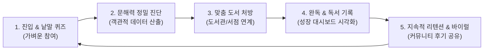
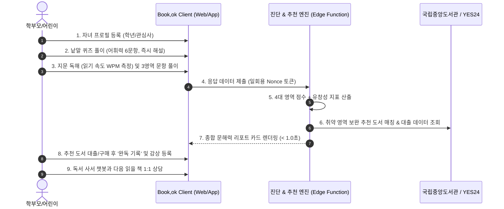

# 📚 Book,ok (북콕) - Product Case Study
## AI 기반 유·초등 맞춤 독서 플랫폼 & 문해력 정밀 진단 솔루션 (Web & App)

<div align="center">


### **"아이에게는 즐거운 읽기 경험을, 학부모에게는 과학적인 독서 나침반을 제공합니다."**

**Product Lead / Product Owner (0 to 1 End-to-End Ownership)**  
문제 정의 ➔ 사용자 가설 수립 ➔ UX/UI 설계 ➔ AI 파이프라인 기획 ➔ 양대 스토어(iOS/Android) 런칭 및 운영 전 과정을 리드한 프로덕트 케이스 스터디

<br/>

[](https://github.com/s-zuni)
[](#-1-executive-summary--north-star-metric)
[](#-4-pm-기획-의사결정--trade-offs)
[](#-6-tech-savvy-pm으로서의-기술적-소통-및-무결성-검증)

<br/>

**[🌐 웹 서비스 바로가기](https://bookok.kr) | [🍎 iOS TestFlight / App Store](https://apps.apple.com) | [🤖 Android APK](https://play.google.com)**

</div>

---

## 📌 Contents
1. [Executive Summary & North Star Metric](#-1-executive-summary--north-star-metric)
2. [Problem Discovery & Hypotheses (문제 정의 및 가설)](#-2-problem-discovery--hypotheses-문제-정의-및-가설)
3. [Core User Journey & Experience (핵심 UX 및 프로덕트 루프)](#-3-core-user-journey--experience-핵심-ux-및-프로덕트-루프)
4. [PM 기획 의사결정 & Trade-offs (핵심 문제 해결)](#-4-pm-기획-의사결정--trade-offs-핵심-문제-해결)
5. [AARRR 퍼널 & 데이터 지표 체계 (Product Metrics)](#-5-aarrr-퍼널--데이터-지표-체계-product-metrics)
6. [Tech-Savvy PM으로서의 기술적 소통 및 무결성 검증](#-6-tech-savvy-pm으로서의-기술적-소통-및-무결성-검증)
7. [주요 화면 및 UX 갤러리 (UI Showcase)](#-7-주요-화면-및-ux-갤러리-ui-showcase)
8. [회고 및 향후 로드맵 (Retrospective & Next Step)](#-8-회고-및-향후-로드맵-retrospective--next-step)

---

## 🧭 1. Executive Summary & North Star Metric

### 🎯 제품 비전
학령기 아동의 스마트폰 노출 증가로 인해 심화되는 **문해력 격차**를 해소하고, 학부모가 겪는 **자녀 수준에 맞는 도서 탐색 비용을 획기적으로 낮추는 맞춤형 독서 성장 파트너**.

### ⭐ North Star Metric (북극성 지표)
> **"월간 맞춤 추천 도서 완독 기록 수 (Monthly Completed Reading Logs from Recommendations)"**
- 진단만 받고 이탈하는 것이 아니라, 진단을 통해 추천받은 책을 실제로 빌리거나 읽고 완독 기록까지 남겼을 때 아이와 학부모가 제품의 핵심 가치(Aha-moment)를 온전히 경험했다고 정의했습니다.

### 🔄 Core Value Loop (핵심 성장 플로우)


---

## 🔍 2. Problem Discovery & Hypotheses (문제 정의 및 가설)

### 🚨 학부모 인터뷰를 통해 도출한 3대 핵심 Pain Point
1. **객관적 기준의 부재**: "아이가 글을 읽기는 하는데, 내용을 제대로 이해하고 있는지 객관적인 점수로 파악하기 어렵다."
2. **도서 선택의 피로도(탐색 비용)**: "베스트셀러나 추천 도서 목록은 너무 방대하고, 정작 내 아이의 취약점(어휘력/추론력/비판력)을 채워줄 책이 무엇인지 모르겠다."
3. **독서 습관 유지의 어려움**: "책을 읽히고 싶어도 아이가 흥미를 느끼지 못해 일방적인 독서 강요와 실랑이가 반복된다."

### 💡 솔루션 가설 수립 및 검증 전략
| 구분 | 해결 가설 (Hypothesis) | 프로덕트 구현 방안 | 검증 기준 (Validation) |
| :--- | :--- | :--- | :--- |
| **가설 1** | **진입 장벽을 낮춘 낱말 퀴즈**가 진단 완료율을 높일 것이다. | 긴 지문 읽기 전 6문항의 즉시 피드백 어휘 퀴즈 배치 | 진단 페이지 진입 대비 낱말 퀴즈 완료율 80% 이상 |
| **가설 2** | 취약 영역에 맞춘 **도서관 실시간 대출 연계**가 행동 전환을 촉진할 것이다. | 국립중앙도서관 빅데이터 연동으로 주변 도서관 소장 여부 원클릭 확인 | 추천 도서 상세 진입 및 대출 정보 클릭률 30% 이상 |
| **가설 3** | **시각화된 성장 리포트**가 지속적인 기록 습관을 형성할 것이다. | 4영역 레이더 차트 및 누적 완독 트래커 제공 | 첫 진단 후 30일 이내 독서 기록 2권 이상 작성률 |

---

## 📱 3. Core User Journey & Experience (핵심 UX 및 프로덕트 루프)



---

## ⚖️ 4. PM 기획 의사결정 & Trade-offs (핵심 문제 해결)

프로덕트를 기획하고 빌드하는 과정에서 마주한 **3대 핵심 트레이드오프와 PM으로서의 의사결정 과정**입니다.

### 💡 Case 1. [사용자 경험] LLM 런타임 생성 ➔ 사전 검증 문항 풀 파이프라인으로 피벗
* **문제 상황**:
  * 초기에는 생성형 AI의 강점을 살려 검사 시작 시점에 OpenAI LLM이 실시간으로 지문과 문제를 생성하도록 기획했습니다.
  * 그러나 실제 테스트 결과 **15초 이상의 심각한 지연 시간(Latency)**이 발생하여 초기 이탈율이 급증했고, 간헐적으로 초등학생 눈높이에 맞지 않는 난해한 어휘나 환각(Hallucination)이 발생하는 교육적 신뢰도 문제가 대두되었습니다.
* **PM의 의사결정**:
  * 실시간 생성의 환상을 버리고, **"사전 확충 ➔ 3단계 자동 검수 ➔ 사람 승인 ➔ DB 시딩"** 구조의 **오프라인 콘텐츠 파이프라인**으로 전면 재설계했습니다.
  * 지문 없이 풀리는 문항(`blind_solvable`), 정답 길이 힌트(`length_cue`), 근거 문장 불일치 문항을 걸러내는 자동 검수 알고리즘을 정의하고, 최종 검수된 문항만 세션 Nonce 기반으로 출제하도록 전환했습니다.
* **비즈니스 결과**:
  * 진단 결과 산출 속도: **15초 ➔ 0.8초 (93% 개선)**
  * 교육 콘텐츠 신뢰도: 검수 통과 문항 100% 출제로 환각 위험 원천 차단.

---

### 💡 Case 2. [플랫폼 전략] 웹 단일 릴리즈 ➔ Capacitor 크로스플랫폼 하이브리드 앱 출시
* **문제 상황**:
  * 유입 데이터 분석 결과 대상 타깃(유·초등 학부모)의 85% 이상이 모바일 기기로 접속하고 있었습니다.
  * 그러나 모바일 웹 환경에서는 자녀의 지속적인 독서를 유도하기 위한 **푸시 알림 수신율과 홈 화면 접근성**에 한계가 존재했습니다. 별도의 iOS/Android 네이티브 앱 개발은 비용과 인력 리소스가 크게 소모되는 상황이었습니다.
* **PM의 의사결정**:
  * Next.js 16 단일 코드베이스를 유지하면서 Capacitor 8을 결합하는 **하이브리드 앱 전략**을 수립했습니다.
  * SEO와 랜딩을 위한 웹 배포(Vercel SSR)와 네이티브 앱스토어 배포(Static Export)를 동시에 지원하는 듀얼 빌드 파이프라인을 구축하고, 애플 로그인 및 소셜 로그인, 햅틱 피드백을 네이티브 플러그인으로 연결했습니다.
* **비즈니스 결과**:
  * 개발 기간 및 유지보수 리소스 **50% 이상 절감**.
  * 애플 앱스토어 및 구글 플레이스토어 동시 진출을 통한 신뢰성 높은 다운로드 채널 확보.

---

### 💡 Case 3. [보안 & 컴플라이언스] 과도한 개인화 기능 ➔ 아동 개인정보 보호(Privacy-First) 우선 정책
* **문제 상황**:
  * AI가 더 정교한 추천을 제공하기 위해 아이의 실명, 생년월일, 학교명 등 상세 데이터를 외부 LLM API에 전달하자는 의견이 있었습니다.
  * 하지만 아동 대상 서비스 특성상 개인정보 유출 시 법적 리스크(개인정보보호법 및 글로벌 아동 온라인 프라이버시 보호법)가 크고, 학부모의 심리적 저항감이 발생할 수 있었습니다.
* **PM의 의사결정**:
  * **"측정할 수 없는 것은 측정한다고 말하지 않고, 불필요한 개인정보는 수집·전송하지 않는다"**는 데이터 원칙을 수립했습니다.
  * 외부 OpenAI API 및 GA 이벤트 전송 페이로드에서 아이의 이름을 원천 제거하고, 익명화된 나이대/영역별 지표만 처리하도록 정책화했습니다.
  * Supabase RLS(Row Level Security)를 엄격히 적용하여 학부모 계정(`parent_id = auth.uid()`)에 종속된 데이터만 조회되도록 통제했습니다.
* **비즈니스 결과**:
  * 앱스토어 개인정보 심사 무결성 통과 및 학부모 안심 신뢰도 확보.

---

## 📊 5. AARRR 퍼널 & 데이터 지표 체계 (Product Metrics)

제품의 지속 가능한 성장을 측정하기 위해 설계한 AARRR 퍼널 지표 체계입니다:

| 단계 (Funnel) | 프로덕트 핵심 액션 (Action) | 주요 측정 지표 (KPI) | 모니터링 방식 |
| :--- | :--- | :--- | :--- |
| **Acquisition (획득)** | 모바일 웹 랜딩, 인스타그램 독서 팁 피드 유입 | 신규 방문자 수 (New Users), 유입 채널별 CAC | GA4 UTM 파라미터 추적 |
| **Activation (활성화)** | 자녀 등록 후 첫 문해력 진단 완료 | **진단 완료율 (Target: >70%)**, 낱말퀴즈 도달률 | 세션 시작 ➔ 완료 이벤트 퍼널 |
| **Retention (유지)** | 추천 도서 조회 및 완독 기록 등록 | **4주 리텐션율**, 월평균 완독 등록 수 (Target: 3권/월) | 코호트 분석 & Recharts 시각화 |
| **Revenue (수익화)** | 도서 제휴 링크(YES24) 클릭 및 추후 프리미엄 리포트 | 제휴 아웃바운드 CTR, 프리미엄 기능 사전 수요도 | 링크 클릭 이벤트 & 대기자 등록률 |
| **Referral (추천)** | 진단 리포트 카드 및 독서 뱃지 SNS 공유 | 카카오톡/인스타 공유 링크 생성 수 및 유입 전환율 | 네이티브 공유 플러그인 클릭 수 |

---

## 🛠️ 6. Tech-Savvy PM으로서의 기술적 소통 및 무결성 검증

비개발자 출신 PM이라도 엔지니어링 및 데이터 구조를 깊이 이해하고 있을 때 올바른 우선순위를 결정할 수 있습니다.

### 📐 데이터 무결성을 위한 39건의 단위 테스트 수립
진단 결과와 점수가 클라이언트에서 위조되거나 조작되지 않도록, **서버 사이드 순수 함수 채점 로직**을 기획하고 39가지 엣지 케이스를 테스트 케이스로 명세화했습니다.

```bash
$ npm test

TAP version 13
# 1. 정답 위치 편향 검증: 보기 셔플 시 특정 번호 쏠림 방지 (기대 정답률 25% 유지)
ok 24 - 정답 위치가 한 번호에 쏠리지 않는다
# 2. 채점 무결성: 전부 오답 시 0점 산출, 시간 소요에 따른 부당 가산점 배제
ok 26 - 전부 오답이면 0점이고 하한을 두지 않는다
# 3. 유창성 지표(WPM) 격리: 비정상 속도(단순 클릭) 시 유창성 점수 산정 제외
ok 31 - 읽기 속도: 유아·비정상 속도는 미산정, 정상은 권장 대비 %
# 4. 클라이언트-서버 규준 일치 검증: 단일 출처(Single Source of Truth) 원칙
ok 32 - 서버 규준과 클라이언트 규준이 일치한다
1..39
# tests 39 | pass 39 | fail 0 (duration: 665ms)
```

### 🤝 기술 스택 선정 및 아키텍처 의사결정
- **Frontend / Hybrid**: Next.js 16 (App Router), React 19, Capacitor 8 (iOS/Android)
- **Design System**: Tailwind CSS v4 기반의 `Forest Green (#2E5A44)` 아이덴티티 수립 ([docs/Design.md](docs/Design.md))
- **Data & Backend**: Supabase (PostgreSQL, RLS 보안 정책, Deno Edge Functions)
- **External Data**: 국립중앙도서관 도서관정보나루 OpenAPI, YES24 상품 OpenAPI, OpenAI GPT-4o
- **CI / CD Pipeline**: Codemagic 기반의 iOS/Android 클라우드 빌드 및 TestFlight 자동 배포 환경 구축

---

## 📸 7. 주요 화면 및 UX 갤러리 (UI Showcase)

| 1. 메인 홈 & 도서 큐레이션 | 2. 낱말 퀴즈 (어휘력) | 3. 4대 영역 심층 진단 |
| :---: | :---: | :---: |
|  |  |  |
| 연령별 추천 및 인기 도서 피드 | 6종 문항 즉시 피드백 어휘 퀴즈 | 사실/추론/비판 독해 및 WPM 측정 |

| 4. 독서 성장 리포트 | 5. AI 어린이 독서 사서 | 6. 학부모 독서 커뮤니티 |
| :---: | :---: | :---: |
|  |  |  |
| 취약 영역 도서 처방 & 통계 | 아이 눈높이 맞춤 1:1 도서 상담 | 학부모 간 독서 팁 및 완독 리뷰 |

---

## 🚀 8. 회고 및 향후 로드맵 (Retrospective & Next Step)

### 📈 프로덕트 성과 및 배운 점
1. **사용자 관점의 문제 정의가 최선의 기술을 결정한다**: 아무리 유행하는 생성형 AI 기술이라도 15초의 지연 시간이 발생하면 유저는 기다려주지 않습니다. '기술 과시'보다 '사용자 경험의 완성도'를 우선순위에 두는 제품 기획의 중요성을 체득했습니다.
2. **0 to 1 런칭 전 주기의 오너십**: 문제 정의부터 시작해 디자인 시스템, DB RLS 보안 정책, 앱스토어 심사 리젝 대응 및 CI/CD 배포 파이프라인 구축까지 전 과정을 직접 조율하며 강한 프로덕트 실행력을 길렀습니다.

### 🔮 다음 프로덕트 로드맵
- [ ] **B2B 기관용 대시보드 확장**: 방과후 교실 및 도서관에서 학급 단위로 문해력을 일괄 진단할 수 있는 관리자 대시보드 개발
- [ ] **초개인화 독서 루틴 푸시 알림**: 주말 독서 알림, 완독 독려 푸시 알림 A/B 테스트를 통한 D30 리텐션 15% 상승 목표
- [ ] **오디오북 및 소리 내어 읽기(STT) 연계**: 아동이 소리 내어 읽은 음성을 분석하여 실시간 발음 및 읽기 유창성을 자동 판독하는 차세대 기능 검토

---

<div align="center">

**Book,ok (북콕) — Crafted with User-Centric Mindset & Data-Driven Strategy**  
**기획 및 프로덕트 리드**: 이승준 (Seungjun Lee)  
Contact: [s-zuni@naver.com](mailto:s-zuni@naver.com) | GitHub: [@s-zuni](https://github.com/s-zuni)

</div>
